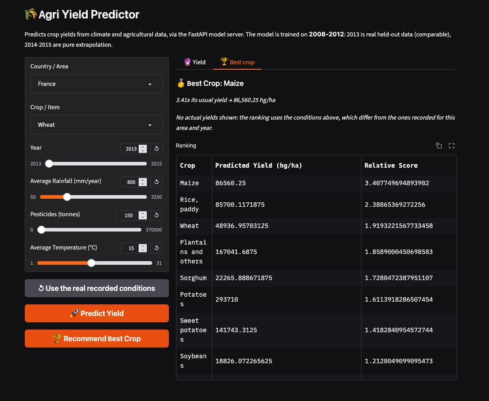
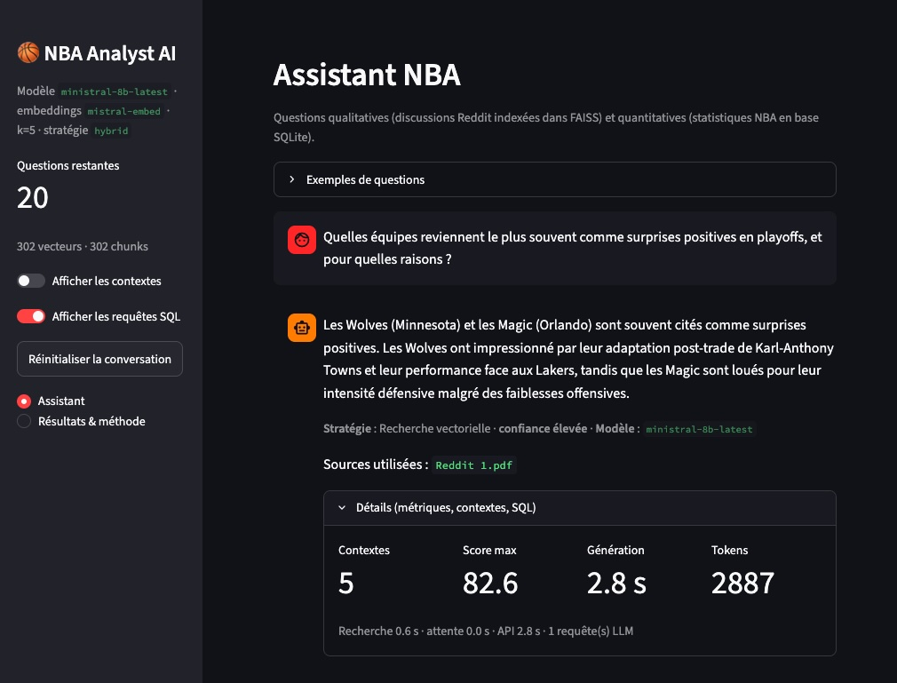
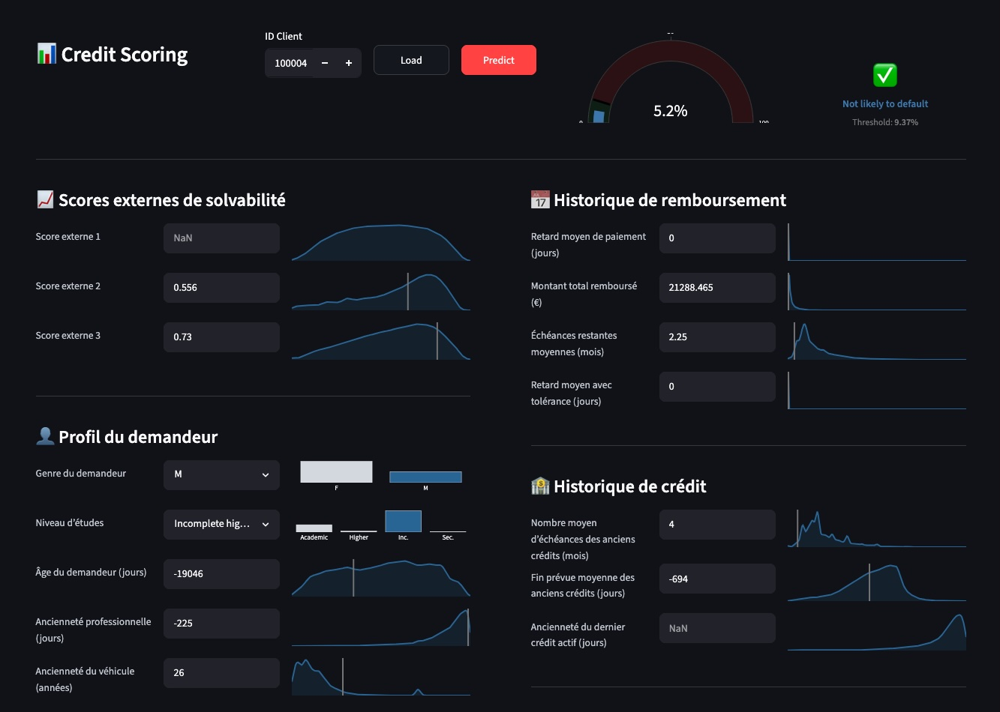
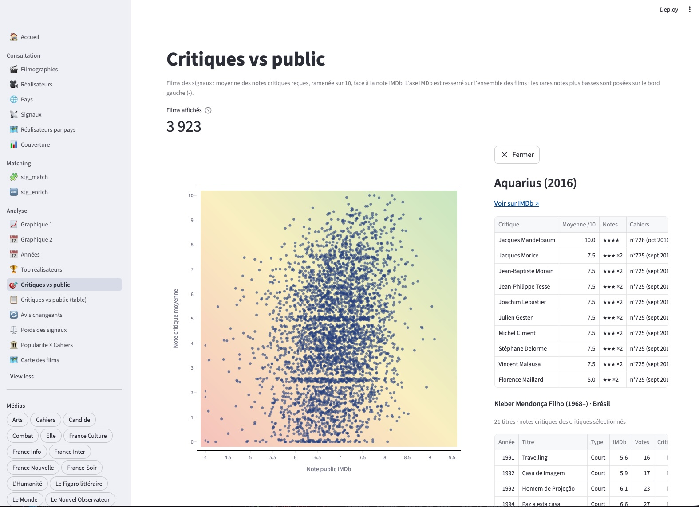

# Science des données &nbsp; × &nbsp; Gestion de projet

---

Ingénieur **data et IA**, passé par le **conseil en stratégie et organisation**, je mets mes compétences au service de projets d'**utilité sociale**.

J’aime autant cadrer et piloter des initiatives complexes, en lien avec la direction et les métiers, que concevoir et développer moi-même les systèmes.

---

Découvrez mon *[cv](01_resume.md)* et mes projets :

  

    

      <a href="02_projects.md#agri" style="text-decoration: none;">Prévision agricole</a>
    

    
  

  

    

      <a href="02_projects.md#nba" style="text-decoration: none;">Chatbot NBA</a>
    

    
  

  

    

      <a href="02_projects.md#credit" style="text-decoration: none;">Scoring crédit</a>
    

    
  

  

    

      <a href="02_projects.md#cine" style="text-decoration: none;"> Suggestion de films</a>
    

    
  

---
